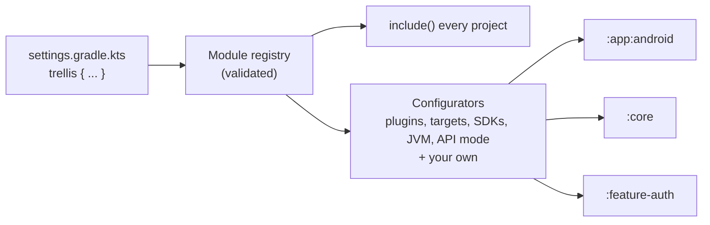

Trellis is a pair of Gradle plugins that turns `settings.gradle.kts` into the single source of truth for your project
structure and build configuration. Declare a module with one line, and Trellis includes it, applies the right plugins,
and configures it with the same conventions as every other module.

```kotlin
// settings.gradle.kts
trellis {
    kmp("feature-auth") {
        android("com.example.feature.auth")
        jvm()
        ios()
    }
}
```

That is the whole setup for a new module. Its `build.gradle.kts` only needs dependencies.

## Why Trellis

Adding a module to a multi-module Kotlin or Android project usually means the same chores every time:

* copy a `build.gradle.kts` from a sibling module and edit it
* repeat the `plugins { }` block, the `android { }` block, the Kotlin targets and the JVM target
* add the new module to `settings.gradle.kts` with `include(...)`
* remember to update every module when something changes, such as `minSdk`, the Java version or the set of targets

The copies drift. One module gets a newer `compileSdk`, another forgets `explicitApi()`, a third still targets Java 11, and
nobody notices until something breaks.

Trellis removes that class of problem:

* Declare a module once, in settings. The declaration says what the module is (Android app, Android library, KMP library,
  JVM module) and which targets it has.
* Shared versions and settings live in one place. Change `javaVersion` or `androidMinSdk` once and every module follows.
* Plugin application, target registration, SDK levels, JVM targets and explicit API mode are derived from the
  declaration, so module build scripts shrink to their dependencies.
* The registry validates the whole build up front: duplicate module names, duplicate Android namespaces, repeated target
  kinds and framework exports of undeclared modules fail at configuration time with a clear message.
* Extra project-wide behavior, such as static analysis or publishing, plugs into the same pipeline from one location
  (see [Extending Trellis](#extending-trellis)).



## Installation

### Requirements

Trellis is developed against Gradle 9.3, Kotlin 2.4.20, Android Gradle Plugin 9.3.3 and JDK 17.

### Artifacts

Trellis ships as two Gradle plugins under the group `com.dzaitsev.trellis`:

| Plugin ID                          | Artifact                  | Purpose                                                          |
|------------------------------------|---------------------------|------------------------------------------------------------------|
| `com.dzaitsev.trellis`             | `trellis-settings-plugin` | Settings plugin: module DSL, registry, project inclusion         |
| `com.dzaitsev.trellis.conventions` | `trellis-project-plugin`  | Configures every project from the root (simple, not isolated)    |
| `com.dzaitsev.trellis.local`       | `trellis-project-plugin`  | Configures only the project it is applied to (Isolated Projects) |

The settings plugin has no Kotlin or Android dependencies. The project plugin carries the configurators.

> [!NOTE]
> Trellis is not yet published to the Gradle Plugin Portal or Maven Central. Install it from your local Maven repository.

### Publish locally

```sh
git clone https://github.com/DmitriyZaitsev/trellis.git
cd trellis
./gradlew publishToMavenLocal
```

### Apply it

Add the local repository and the settings plugin in `settings.gradle.kts`:

```kotlin
pluginManagement {
    repositories {
        mavenLocal()
        google()
        mavenCentral()
        gradlePluginPortal()
    }
}

plugins {
    id("com.dzaitsev.trellis") version "0.1.0"
}

trellis {
    createMissingDirectories()

    java("service") { mainClass = "example.MainKt" }
    androidApp("app", "example.app") { usesCompose = true }
    kmp("shared") {
        android("example.shared")
        jvm()
        ios { framework("Shared") }
        js(browser)
        wasmJs(browser)
    }
}
```

Then apply the conventions plugin in the root `build.gradle.kts`. Put the Kotlin, Android and Compose plugins your
modules need on the classpath with `apply false`, so Trellis can apply them with the versions you chose:

```kotlin
plugins {
    id("org.jetbrains.kotlin.jvm") version "2.4.20" apply false
    id("org.jetbrains.kotlin.multiplatform") version "2.4.20" apply false
    id("com.android.application") version "9.3.3" apply false
    id("com.android.kotlin.multiplatform.library") version "9.3.3" apply false
    id("org.jetbrains.kotlin.plugin.compose") version "2.4.20" apply false
    id("org.jetbrains.compose") version "1.12.1" apply false
    id("com.dzaitsev.trellis.conventions") version "0.1.0"
}

trellis {
    kotlinVersion = "2.4.20"
    javaVersion = 17
    androidMinSdk = 24
    androidTargetSdk = 37
}
```

Only list the plugins your declared modules use. Sync the project and every declared module is configured.

## Quick start

With the setup above, adding a module is one line in settings plus its sources:

```kotlin
trellis {
    kmp("feature-auth") {
        android("com.example.feature.auth")
        jvm()
        ios()
    }
}
```

The module's `build.gradle.kts` contains only what is specific to it:

```kotlin
kotlin {
    sourceSets.commonMain.dependencies {
        implementation(project(":core"))
    }
}
```

There is no `plugins { }` block, no `android { }` block and no target list. With `createMissingDirectories()` enabled,
Trellis also creates the module directory the first time it appears, so you can declare a module before touching the file
system.

## Declaring modules

Modules are declared inside `trellis { }` in `settings.gradle.kts`. Use `group("name") { ... }` to nest modules; a module
`shared` inside `group("app")` becomes the project `:app:shared`, located in `app/shared`.

```kotlin
trellis {
    group("app") {
        androidApp("androidApp", "com.example.app") { usesCompose = true }
        kmp("shared") {
            usesCompose = true
            android("com.example.app.shared")
            ios { framework("Shared") { export(":core") } }
            jvm()
        }
    }
    kmp("core") {
        android("com.example.core")
        ios()
        jvm()
    }
}
```

### Module kinds

| Declaration                                 | Applied plugins                                                                                                     |
|---------------------------------------------|---------------------------------------------------------------------------------------------------------------------|
| `androidApp(name, namespace) { ... }`       | `com.android.application`, plus `kotlin-android` when AGP does not provide built-in Kotlin                          |
| `androidLibrary(name, namespace) { ... }`   | `com.android.library`, plus `kotlin-android` under the same condition                                               |
| `java(name) { ... }`                        | `org.jetbrains.kotlin.jvm`, plus `application` when `mainClass` is set                                              |
| `kmp(name) { options and targets }`         | `org.jetbrains.kotlin.multiplatform`, plus `com.android.kotlin.multiplatform.library` when it has an Android target |
| `root(name)`                                | None. For the root project or an aggregator without sources                                                         |

Parameters carry a module's identity: its name, and the namespace of Android modules. Every optional setting goes in
the trailing block, which you can omit: `java("lib")` and `androidLibrary("ui", "com.example.ui")` are complete
declarations.

Options:

* `usesCompose = true` applies the Compose compiler plugin, and on `java` and `kmp` modules also Compose Multiplatform.
  On a `kmp` module with an Android target it also enables Android resources, which Compose resources need.
  Runtime and UI dependencies stay yours.
* `hasExplicitApi = true` enables Kotlin `explicitApi()` for the module (off by default).
* `autoConfigureTargets = false` in a `kmp` block opts that module out of target registration when it needs
  hand-written target configuration in its own build script.
* `group`, `version` and `mainClass` in a `java` block set the Gradle group, version and application entry point.

`usesCompose` and `hasExplicitApi` belong to `ModuleOptionsScope`, which every module block implements. Set them for
many modules at once with `defaults { }`: it applies to every module declared after it in the same container and its
nested groups, before the module's own block, which can override it. Declare it before the first module or group:

```kotlin
trellis {
    defaults { hasExplicitApi = true }

    group("feature") {
        defaults { usesCompose = true }
        kmp("profile") { jvm() }       // explicit API and Compose
    }
    java("tools") { hasExplicitApi = false }
}
```

A preset written once applies to any module kind:

```kotlin
fun ModuleOptionsScope.uiDefaults() {
    usesCompose = true
    hasExplicitApi = true
}

trellis {
    androidLibrary("ui", "com.example.ui") { uiDefaults() }
    kmp("shared") {
        uiDefaults()
        jvm()
    }
}
```

Android apps and libraries declare product flavors with a builder. Dimensions are prioritized in the order you declare
them, and `applicationIdSuffix` applies to apps only:

```kotlin
androidApp("app", "com.example.app") {
    flavors {
        dimension("env") {
            flavor("dev", isDefault = true) { applicationIdSuffix = ".dev" }
            flavor("prod")
        }
        dimension("market") {
            flavor("eu")
            flavor("us")
        }
    }
}
```

### KMP targets

Every target is one call inside `kmp { }`. Targets with platform variants take them as arguments, and no arguments means
the default set:

| Call                                                    | Registers                                                                                    |
|---------------------------------------------------------|----------------------------------------------------------------------------------------------|
| `jvm()`                                                 | JVM                                                                                          |
| `android(namespace)`                                    | Android target of `com.android.kotlin.multiplatform.library`, with host tests                |
| `ios(vararg hosts) { ... }`                             | `iosArm64` and `iosSimulatorArm64`; pass `iosX64` to add Intel simulators                    |
| `tvos(vararg hosts)`, `watchos(vararg hosts)`           | Device and Apple Silicon simulator targets                                                   |
| `macos(isApplication)`                                  | `macosArm64`                                                                                 |
| `linux(isApplication)`, `mingw(isApplication)`          | `linuxX64`, `mingwX64`                                                                       |
| `androidNative(vararg hosts)`                           | Kotlin/Native for the Android NDK: `androidNativeArm64` and `androidNativeX64`; not the app target |
| `desktop(isApplication)`                                | `macos()`, `linux()` and `mingw()` together                                                  |
| `js(vararg environments, isApplication)`, `wasmJs(...)` | `browser` and/or `nodeJs`, both by default                                                   |

With `isApplication = true`, the target also registers an executable binary.

Selections use the scope's constants:

```kotlin
kmp("shared") {
    ios(iosArm64, iosSimulatorArm64, iosX64)
    js(browser, isApplication = true)
    wasmJs(browser, nodeJs)
}
```

An iOS framework is declared inside the `ios` block. Exported project paths must be declared modules; Trellis also adds
them as `api` dependencies of the iOS main source set, which Kotlin/Native requires:

```kotlin
ios {
    framework("Shared") {
        export(":core", ":domain")
        isStatic = true
    }
}
```

Declaring the same target kind twice in one module is rejected.

## Conventions

Conventions are the values shared by all modules. Declare them once in settings; both the root and the local plugin
read them from there:

```kotlin
// settings.gradle.kts
trellis {
    projectConventions {
        kotlinVersion = "2.4.20"
        javaVersion = 17
        androidMinSdk = 24
        androidTargetSdk = 37
    }
}
```

In root mode you can instead, or additionally, set them in the root build script's `trellis { }` block; values assigned
there win over settings. That is useful when they come from a version catalog, which settings scripts cannot read.

| Property           | Meaning                                                            |
|--------------------|--------------------------------------------------------------------|
| `kotlinVersion`    | Kotlin language and API version for every Kotlin module, for example `"2.4"`; unset keeps the compiler's default |
| `javaVersion`      | JVM bytecode target for Kotlin, Java and Android, for example `17` |
| `androidMinSdk`    | `minSdk` for every Android module and KMP Android target           |
| `androidTargetSdk` | `compileSdk` for every Android module and KMP Android target       |
| `useJavaToolchain` | Compile with a JDK toolchain of `javaVersion` (default `false`)    |

What Trellis configures from a declaration:

* the Kotlin, Android and Compose plugins implied by the module kind
* Kotlin Multiplatform targets and the default source-set hierarchy
* JVM target for Kotlin, Java and Android compilations
* Android namespace, `compileSdk`, `minSdk`, Java compile options, Compose build feature and product flavors
* host tests for KMP Android targets, plus Android resources when the module uses Compose
* explicit API mode where requested
* group, version, test logging and the `application` entry point for `java` modules

Values are set on extensions, not tasks, so a module's own `build.gradle.kts` can still override a scalar value when it
has a good reason. Declared targets and host tests are additive; opt a module out in its settings declaration.

## Isolated Projects mode

Root mode uses `allprojects`, which Gradle's Isolated Projects feature does not allow. If you need isolation, use the local
plugin. It reads conventions only from settings, so declare them with `projectConventions { }` as shown in
[Conventions](#conventions).

Replace `com.dzaitsev.trellis.conventions` in the root build script with
`id("com.dzaitsev.trellis.local") version "0.1.0" apply false`, keeping the Kotlin and Android plugins with
`apply false`. Then apply it in each declared module:

```kotlin
// <module>/build.gradle.kts
plugins { id("com.dzaitsev.trellis.local") }
```

The settings plugin hands each project a plain-data copy of the registry. The local plugin configures only its own project,
before the module script runs. Do not combine local and root conventions for the same module.

```sh
./gradlew :service:compileKotlin --configuration-cache -Dorg.gradle.unsafe.isolated-projects=true
```

Coverage today: JVM and JVM-only KMP modules are tested with Isolated Projects and configuration-cache reuse. The Kotlin
Gradle plugin 2.4.20 still reads other projects for Kotlin/JS, and Android and Compose are tested in root mode only, so
builds containing those are not covered by the isolation guarantee.

## Extending Trellis

The built-in behavior is a list of small `Configurator` objects. You can run your own in the same pipeline, so a static
analyzer, a publishing setup or a dependency policy is defined once and reaches every module, with access to what Trellis
knows about each one.

A configurator is a function interface:

```kotlin
public fun interface Configurator<in M : ModuleModel, in E : TrellisProjectExtension> {
    public fun configure(project: Project, module: M, extension: E)
}
```

It receives the Gradle `Project`, the declared `Module` (`Module.KmpLibrary`, `Module.AndroidApp`, and so on) and your
extension with the shared conventions.

### 1. Create a build-logic project

Put your convention plugin in an included build so the whole project shares it from one place:

```kotlin
// settings.gradle.kts
pluginManagement {
    includeBuild("build-logic")
    repositories {
        mavenLocal()
        google()
        mavenCentral()
        gradlePluginPortal()
    }
}
```

```kotlin
// build-logic/settings.gradle.kts
rootProject.name = "build-logic"
```

```kotlin
// build-logic/build.gradle.kts
plugins { `kotlin-dsl` }

repositories {
    mavenLocal()
    google()
    mavenCentral()
    gradlePluginPortal()
}

dependencies {
    implementation("com.dzaitsev.trellis:trellis-project-plugin:0.1.0")
    implementation("io.gitlab.arturbosch.detekt:detekt-gradle-plugin:1.23.8") // used by the example below
}

gradlePlugin {
    plugins {
        create("acmeConventions") {
            id = "com.acme.conventions"
            implementationClass = "com.acme.build.AcmeConventionsPlugin"
        }
    }
}
```

### 2. Add your own settings to the extension

Extend `TrellisProjectExtension` with any `Property` you need. Gradle creates the implementation for you:

```kotlin
// build-logic/src/main/kotlin/com/acme/build/AcmeExtension.kt
package com.acme.build

import com.dzaitsev.trellis.plugin.TrellisProjectExtension
import org.gradle.api.file.RegularFileProperty

interface AcmeExtension : TrellisProjectExtension {
    val detektConfig: RegularFileProperty
}
```

### 3. Write a configurator

This one applies Detekt to every module except the root, using the shared config file:

```kotlin
// build-logic/src/main/kotlin/com/acme/build/DetektConfigurator.kt
package com.acme.build

import com.dzaitsev.trellis.Module
import com.dzaitsev.trellis.plugin.Configurator
import io.gitlab.arturbosch.detekt.extensions.DetektExtension
import org.gradle.api.Project
import org.gradle.kotlin.dsl.configure

class DetektConfigurator : Configurator<Module, AcmeExtension> {
    override fun configure(project: Project, module: Module, extension: AcmeExtension) {
        if (module is Module.Root) return

        project.pluginManager.apply("io.gitlab.arturbosch.detekt")
        project.extensions.configure<DetektExtension> {
            buildUponDefaultConfig = true
            parallel = true
            config.setFrom(extension.detektConfig)
        }
    }
}
```

Because the configurator sees the module, it can branch on what the module is, or on a capability shared by several
kinds (`Module.UsesCompose`, `HasAndroidNamespace`):

```kotlin
if ((module as? Module.UsesCompose)?.usesCompose == true) {
    // extra rules for every Compose module: Android, JVM or Multiplatform
}
```

Guard work that depends on other plugins with `project.pluginManager.withPlugin("...") { }`, so ordering never matters.

### 4. Assemble the plugin

Subclass `TrellisProjectPlugin`, keep the built-in configurators, and add yours:

```kotlin
// build-logic/src/main/kotlin/com/acme/build/AcmeConventionsPlugin.kt
package com.acme.build

import com.dzaitsev.trellis.Module
import com.dzaitsev.trellis.configurator.defaultProjectModuleConfigurators
import com.dzaitsev.trellis.plugin.Configurator
import com.dzaitsev.trellis.plugin.TrellisProjectPlugin
import com.dzaitsev.trellis.plugin.findModule
import org.gradle.api.Project

class AcmeConventionsPlugin :
    TrellisProjectPlugin<Module, AcmeExtension>(
        extensionName = "trellis",
        extensionType = AcmeExtension::class,
    ) {
    override fun moduleOf(project: Project): Module? = project.findModule()

    override fun immediateConfigurators(
        module: Module,
        extension: AcmeExtension,
    ): List<Configurator<Module, AcmeExtension>> =
        defaultProjectModuleConfigurators<AcmeExtension>(module) + DetektConfigurator()
}
```

Drop the built-ins from the list if you want full control, or reorder them. `moduleOf` returning `null` leaves a project
untouched.

### 5. Use it

Apply your plugin in the root build script instead of `com.dzaitsev.trellis.conventions`:

```kotlin
plugins {
    id("org.jetbrains.kotlin.multiplatform") version "2.4.20" apply false
    id("com.acme.conventions")
}

trellis {
    kotlinVersion = "2.4.20"
    javaVersion = 17
    androidMinSdk = 24
    androidTargetSdk = 37
    detektConfig = layout.projectDirectory.file("config/detekt.yml")
}
```

Every module now gets Detekt, and changing the rules is a one-file edit.

### Choosing when a configurator runs

`TrellisProjectPlugin` offers three hooks:

| Override                 | Runs                                                                                  | Typical use                              |
|--------------------------|---------------------------------------------------------------------------------------|------------------------------------------|
| `immediateConfigurators` | After the root script has evaluated, before any subproject script, for every project | Applying plugins, setting conventions    |
| `lateConfigurators`      | In each project's `afterEvaluate`, after its own script                               | Reading what a module script registered  |
| `rootConfigurators`      | Once, on the root project                                                             | Aggregate tasks such as "run all checks" |

Other good candidates for a configurator: Spotless or ktlint, Kover coverage, publishing and signing, dependency locking,
shared test dependencies, or opinionated compiler flags.

### Extending local mode

`com.dzaitsev.trellis.local` itself is not subclassable, but it is short and its behavior is public. To add configurators in
Isolated Projects mode, write your own `Plugin<Project>` and apply it per module instead:

```kotlin
class AcmeLocalPlugin : Plugin<Project> {
    override fun apply(project: Project) {
        val module = project.findModule() ?: return
        val conventions = requireNotNull(project.extensions.getByType<ModuleRegistryHolder>().projectConventions) {
            "Declare trellis { projectConventions { ... } } in settings first"
        }
        val extension = project.extensions.create<AcmeExtension>("trellis")
        extension.useSettingsConventions(conventions)
        (defaultProjectModuleConfigurators<AcmeExtension>(module) + DetektConfigurator())
            .forEach { it.configure(project, module, extension) }
    }
}
```

Keep configurators that touch only their own `project` if you want to stay compatible with Isolated Projects.

### Troubleshooting

* `Module registry holder was loaded by a different class loader`: Trellis ended up on two classpaths. Apply the settings
  plugin only through the settings `plugins { }` block, and keep Trellis out of `buildSrc`.
* `No module registry found`: the `com.dzaitsev.trellis` plugin is missing from `settings.gradle.kts`.
* `declares more than one target of kind`: a `kmp { }` block repeats a target such as `js()`. Merge the declarations.

## Limitations

* Not published to a public repository yet; install through `publishToMavenLocal`.
* Root mode is not compatible with Isolated Projects. Use the local plugin where you need isolation.
* Product flavors are supported for Android apps and libraries only, not for the KMP Android target.

## Development

```sh
./gradlew ciCheck
```

runs the checks for both plugins, including the functional tests that resolve the artifacts from a Maven repository the way
real consumers do.

## License

Trellis is licensed under the [Apache License, Version 2.0](LICENSE).
