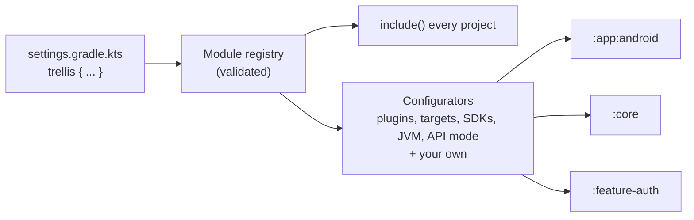

# Declare once. Configure together.

Declare your Android and Kotlin Multiplatform (KMP) modules in `settings.gradle.kts`, and configure them with shared
build conventions across your mobile project. The same DSL also supports web, desktop and standalone JVM modules.

---

Trellis is a set of Gradle plugins that connects your module declarations to their build configuration. For each declared
module, it includes the project, applies the plugins its module type needs, and configures targets and shared settings
such as Android SDK levels and Kotlin compiler settings. **Conventions** are those shared build settings.

Without Trellis, settings includes the module:

```kotlin
// settings.gradle.kts
include(":feature")
```

Its plugins, Android namespace and Kotlin targets are then configured separately in `feature/build.gradle.kts`.
With Trellis, the settings declaration describes the module as well as including it:

```kotlin
// settings.gradle.kts — after installing Trellis
trellis {
    kmp("feature") {
        android("com.example.feature")
        ios()
    }
}
```

This declares `:feature` with Android and iOS targets. Once the shared setup is in place, its
`build.gradle.kts` can focus on dependencies and other module-specific configuration.

## Contents

* [Why Trellis](#why-trellis)
* [Installation](#installation)
* [Quick start: shared Android and iOS code](#quick-start-shared-android-and-ios-code)
* [Connecting an Android app](#connecting-an-android-app)
* [Sharing beyond mobile](#sharing-beyond-mobile)
* [Migrating an existing project](#migrating-an-existing-project)
* [Declaring modules](#declaring-modules)
* [Conventions](#conventions)
* [Isolated Projects mode](#isolated-projects-mode)
* [Extending Trellis](#extending-trellis)
* [Troubleshooting](#troubleshooting)
* [Limitations](#limitations)
* [Development](#development)

## Why Trellis

Adding a feature or shared module to a mobile project usually means the same chores every time:

* copy a `build.gradle.kts` from a sibling module and edit it
* repeat the `plugins { }` block, the `android { }` block, the Kotlin targets and the JVM target
* add the new module to `settings.gradle.kts` with `include(...)`
* remember to update every module when something changes, such as `minSdk`, the Java version or the set of targets

The copies drift. One module gets a newer `compileSdk`, another forgets `explicitApi()`, a third is missing an iOS simulator target, and
nobody notices until something breaks.

Trellis reduces that duplication:

* Declare a module once, in settings. The declaration says what the module is (Android app, Android library, KMP library,
  JVM module) and which targets it has.
* Shared versions and settings live in one place. Change `javaVersion` or `androidMinSdk` once and every module follows.
* Plugin application, target registration, SDK levels, JVM targets and explicit API mode are derived from the
  declaration, so module build scripts focus on dependencies and module-specific behavior.
* The registry validates the whole build up front: duplicate module names, duplicate Android namespaces, repeated target
  kinds and framework exports of undeclared modules fail at configuration time with a clear message.
* Extra project-wide behavior, such as static analysis or publishing, plugs into the same pipeline from one location
  (see [Extending Trellis](#extending-trellis)).

### When Trellis helps

Trellis is most useful when Android feature modules share the same SDK and compiler settings, or when KMP modules
repeat the same Android and iOS targets. It gives those modules a consistent setup and a central place to change it. For a
small build with little repeated configuration, maintaining the build scripts directly may be simpler.

If you already use convention plugins, Trellis adds a central description of your modules: their types, targets and
options. It uses that description to include projects, validate declarations and apply configuration. Your existing
convention plugins can continue to handle behavior outside Trellis's built-in configuration; avoid configuring the same
plugins and targets twice. [Extending Trellis](#extending-trellis) shows how to make custom build logic use the same module
declarations.

Trellis handles build configuration. You still write the source code, choose dependencies and plugin versions, and
configure behavior specific to an individual module.



## Installation

### Requirements

Trellis is developed against Kotlin 2.4.20 and JDK 17. JVM and Multiplatform builds are tested with Gradle 9.3; Android
builds need Android Gradle Plugin 9.3.3, which requires Gradle 9.5 or newer, and are tested with Gradle 9.8.

### Artifacts

Trellis publishes two artifacts under the group `com.dzaitsev.trellis`, exposing three plugin IDs:

| Plugin ID                          | Artifact                  | Purpose                                                          |
|------------------------------------|---------------------------|------------------------------------------------------------------|
| `com.dzaitsev.trellis`             | `trellis-settings-plugin` | Settings plugin: module DSL, registry, project inclusion         |
| `com.dzaitsev.trellis.conventions` | `trellis-project-plugin`  | Configures every project from the root (simple, not isolated)    |
| `com.dzaitsev.trellis.local`       | `trellis-project-plugin`  | Configures only the project it is applied to (Isolated Projects) |

The settings plugin reads module declarations and includes projects. The project artifact provides two ways to apply
configuration: use `com.dzaitsev.trellis.conventions` once in the root build script for the default setup, or
`com.dzaitsev.trellis.local` in each module for [Isolated Projects mode](#isolated-projects-mode).
The settings plugin has no Kotlin or Android dependencies.

The plugins are published to the [Gradle Plugin Portal](https://plugins.gradle.org/plugin/com.dzaitsev.trellis).

## Quick start: shared Android and iOS code

This example creates a KMP library for code shared between an Android app and an iOS app. Start with a Gradle build
using the Kotlin DSL and a Gradle wrapper. Use JDK 17 and an Android-compatible Gradle version from
[Requirements](#requirements), and install Android SDK 37. Building the iOS framework also requires macOS and Xcode.

### 1. Declare the shared module in settings

Add the following to the root `settings.gradle.kts`. In an existing build, merge these blocks with the ones already there;
keep `pluginManagement` first and the `plugins` block before other configuration.

```kotlin
// settings.gradle.kts
pluginManagement {
    repositories {
        google()
        mavenCentral()
        gradlePluginPortal()
    }
}

plugins {
    id("com.dzaitsev.trellis") version "1.0.0"
}

dependencyResolutionManagement {
    repositories {
        google()
        mavenCentral()
    }
}

rootProject.name = "trellis-mobile"

trellis {
    createMissingDirectories()
    kmp("shared") {
        android("com.example.shared")
        ios { framework("Shared") }
    }
}
```

Trellis includes `:shared`, configures its Android library target, and registers iOS device and Apple Silicon simulator
targets. The iOS targets each produce a framework named `Shared`. You do not need a separate `include(":shared")` call.

### 2. Apply shared configuration from the root

Declare the Kotlin, Android and Compose plugins your modules need **with their versions in the root
`build.gradle.kts`**, using `apply false`. This makes them available for Trellis to apply to the appropriate modules.
Apply `com.dzaitsev.trellis.conventions` in the same block, without `apply false`.

For the shared Android/iOS library above, the root build script is:

```kotlin
// build.gradle.kts
plugins {
    id("org.jetbrains.kotlin.multiplatform") version "2.4.20" apply false
    id("com.android.kotlin.multiplatform.library") version "9.3.3" apply false
    id("com.dzaitsev.trellis.conventions") version "1.0.0"
}

trellis {
    javaVersion = 17
    androidMinSdk = 24
    androidTargetSdk = 37
}
```

`apply false` makes the Kotlin and Android plugins available without applying them to the root project. Trellis applies
them to the declared modules that need them. You choose plugin versions; Trellis does not choose them for you.

List only the plugins your modules use, and keep their versions centralized here instead of repeating them in module
build scripts. Version catalog aliases with `apply false` can serve the same purpose if your build uses a catalog.

Here, `androidTargetSdk` sets the Android compile SDK and, for Android apps, the target SDK. `javaVersion` keeps Android
Java and Kotlin JVM bytecode targets aligned.

### 3. Add shared code and build it

Create `shared/src/commonMain/kotlin/com/example/shared/Greeting.kt`:

```kotlin
package com.example.shared

class Greeting {
    fun message(): String = "Hello from shared Kotlin code"
}
```

The resulting layout is:

```text
trellis-mobile/
├── settings.gradle.kts
├── build.gradle.kts
├── gradlew
├── gradle/wrapper/…
└── shared/
    └── src/commonMain/kotlin/com/example/shared/Greeting.kt
```

List the module's generated build tasks from the root directory:

```sh
./gradlew :shared:tasks --all
```

On macOS with Xcode installed, build the framework for an Apple Silicon iOS simulator:

```sh
./gradlew :shared:linkDebugFrameworkIosSimulatorArm64
```

This compiles the shared code into a `Shared.framework` for that simulator. Wiring the framework into an Xcode app is a
separate integration step; Trellis configures its Gradle build. See [KMP targets](#kmp-targets) for additional Apple
targets, framework exports and XCFramework packaging.

No `shared/build.gradle.kts` is needed for this dependency-free example. When you add dependencies or module-specific
configuration, create that file. For example, to use Kotlin's test library in shared tests:

```kotlin
// shared/build.gradle.kts
kotlin {
    sourceSets.commonTest.dependencies {
        implementation(kotlin("test"))
    }
}
```

`createMissingDirectories()` creates declared module directories during Gradle configuration. It does not generate
source files or build scripts. Without this option, module directories must already exist.

## Connecting an Android app

To use the shared module from an Android app, keep your existing app sources, manifest and resources. Replace its
ordinary `include(":app")` with this declaration in the settings `trellis { }` block:

```kotlin
androidApp("app", "com.example.app")
```

Add the Android application plugin to the root build script's existing `plugins { }` block:

```kotlin
id("com.android.application") version "9.3.3" apply false
```

Trellis applies the plugin and configures the namespace and shared SDK levels. Remove the corresponding plugin and
shared settings from the app build script, keeping app-specific configuration such as signing and build types. Add
the shared module dependency in `app/build.gradle.kts`:

```kotlin
dependencies {
    implementation(project(":shared"))
}
```

Your Android code can now call `com.example.shared.Greeting().message()`. Build the app with:

```sh
./gradlew :app:assembleDebug
```

For a new app, create its sources and manifest as usual; Trellis does not generate an app UI or manifest. Module
declarations configure builds; dependencies between modules remain explicit.

### Using Compose

Set `usesCompose = true` in the declaration of a module that uses Compose:

```kotlin
androidApp("app", "com.example.app") { usesCompose = true }
```

Add the Compose compiler plugin to the root `plugins { }` block. A KMP module sharing Compose UI also needs the Compose
Multiplatform plugin:

```kotlin
id("org.jetbrains.kotlin.plugin.compose") version "2.4.20" apply false
// Also needed when a KMP module uses Compose:
id("org.jetbrains.compose") version "1.12.1" apply false
```

Add Compose UI dependencies in the module build script. See [Module kinds](#module-kinds) for the plugin mapping and
options.

## Sharing beyond mobile

An Android/iOS project can grow to share code with web and desktop clients or a JVM service. The same module DSL
covers these targets too. For example, this settings block combines an Android app, a multiplatform library and a
standalone Kotlin/Java JVM application:

```kotlin
// settings.gradle.kts — an expanded alternative to the quick-start declarations
trellis {
    androidApp("app", "com.example.app") { usesCompose = true }

    kmp("shared") {
        android("com.example.shared")
        ios { framework("Shared") }
        jvm()
        js(browser)
        wasmJs(browser)
        desktop()
    }

    java("service") { mainClass = "example.MainKt" }
}
```

Choose the targets your project needs:

* `jvm()` adds a JVM target to the shared KMP library, usable by JVM services or Compose Desktop apps.
* `js(browser)` and `wasmJs(browser)` add browser targets; use `nodeJs` for Node.js environments.
* `desktop()` adds Kotlin/Native targets for macOS, Linux and Windows. For a JVM-based Compose Desktop app, use `jvm()`.
* `java("service")` declares a separate JVM module supporting Kotlin and Java sources. With `mainClass`, it becomes a
  runnable application; omit that option for a library.

For a project using Android, KMP, standalone JVM modules and Compose, the complete root plugin setup is:

```kotlin
// Root build.gradle.kts
plugins {
    id("org.jetbrains.kotlin.jvm") version "2.4.20" apply false
    id("org.jetbrains.kotlin.multiplatform") version "2.4.20" apply false
    id("com.android.application") version "9.3.3" apply false
    id("com.android.kotlin.multiplatform.library") version "9.3.3" apply false
    id("org.jetbrains.kotlin.plugin.compose") version "2.4.20" apply false
    id("org.jetbrains.compose") version "1.12.1" apply false
    id("com.dzaitsev.trellis.conventions") version "1.0.0"
}
```

Keep plugin versions here so Trellis can apply them consistently across modules. Include only the plugins your modules
use: the Compose Multiplatform plugin is needed when a KMP or JVM module uses Compose, and the Kotlin JVM plugin is
needed for standalone `java(...)` modules. Web and native desktop targets use the Kotlin Multiplatform plugin.
For `androidLibrary(...)` modules, also declare `com.android.library` with the same AGP version and `apply false`.

As with mobile modules, add source code and dependencies in each module; declaring targets does
not create clients or connect the service to shared code. Platform tooling and host requirements still apply.
See [KMP targets](#kmp-targets) for target variants, executable binaries and framework packaging.

## Migrating an existing project

You can adopt Trellis one module at a time. Projects included with ordinary `include(...)` calls and absent from Trellis
module declarations keep their existing configuration.

For example, an Android feature library using AGP's built-in Kotlin support might have this `feature-profile/build.gradle.kts`:

```kotlin
plugins {
    id("com.android.library")
}

android {
    namespace = "com.example.feature.profile"
    compileSdk = 37
    defaultConfig { minSdk = 24 }
}

dependencies {
    implementation(project(":shared"))
}
```

To migrate it:

1. Apply the Trellis settings and root conventions plugins as shown in the quick start. Add
   `id("com.android.library") version "9.3.3" apply false` to the root `plugins { }` block.
2. Replace `include(":feature-profile")` with the following declaration in the settings `trellis { }` block:

   ```kotlin
   androidLibrary("feature-profile", "com.example.feature.profile")
   ```

3. Set `androidMinSdk = 24` and `androidTargetSdk = 37` in the root `trellis { }` block. Use the SDK levels your project
   requires; these values apply to all migrated Android modules.
4. Remove the Android library plugin declaration and the migrated namespace and SDK settings from the feature build
   script. Keep its dependencies and any other module-specific configuration.

The module build script becomes:

```kotlin
// feature-profile/build.gradle.kts
dependencies {
    implementation(project(":shared"))
}
```

The existing `:shared` module can stay on its current setup. Run `./gradlew :feature-profile:assembleDebug` and the
feature's existing tests before migrating the next module. Keep source directories and project paths unchanged during
this first migration so the configuration change is easy to verify.

For KMP modules, move the Android namespace and target declarations into `kmp(...)`, following the quick start. Keep
source-set dependencies in the module build script. Match the existing iOS targets and framework names when moving
those declarations, then remove their old registration to avoid duplicates. If a KMP module needs to keep custom target
registration, use `autoConfigureTargets = false` as described below.

## Declaring modules

Modules are declared inside `trellis { }` in `settings.gradle.kts`. Use `group("name") { ... }` to nest modules; a module
`shared` inside `group("app")` becomes the project `:app:shared`, located in `app/shared`.

```kotlin
trellis {
    group("app") {
        androidApp("androidApp", "com.example.app") { usesCompose = true }
        kmp("shared") {
            usesCompose = true
            android("com.example.app.shared")
            ios { framework("Shared") { export(":core") } }
        }
    }
    kmp("core") {
        android("com.example.core")
        ios()
    }
}
```

### Module kinds

| Declaration                                 | Applied plugins                                                                                                     |
|---------------------------------------------|---------------------------------------------------------------------------------------------------------------------|
| `androidApp(name, namespace) { ... }`       | `com.android.application`, plus `kotlin-android` when AGP does not provide built-in Kotlin                          |
| `androidLibrary(name, namespace) { ... }`   | `com.android.library`, plus `kotlin-android` under the same condition                                               |
| `java(name) { ... }`                        | `org.jetbrains.kotlin.jvm`, plus `application` when `mainClass` is set                                              |
| `kmp(name) { options and targets }`         | `org.jetbrains.kotlin.multiplatform`, plus `com.android.kotlin.multiplatform.library` when it has an Android target |
| `root(name)`                                | None. For the root project or an aggregator without sources                                                         |

Parameters carry a module's identity: its name, and the namespace of Android modules. Every optional setting goes in
the trailing block, which you can omit: `androidApp("app", "com.example.app")` and
`androidLibrary("ui", "com.example.ui")` are complete declarations.

For supporting JVM modules, `java(...)` applies the Kotlin JVM plugin and supports Kotlin and Java sources. Setting
`mainClass` also makes the module an application.

Options:

* `usesCompose = true` applies the Compose compiler plugin, and on `java` and `kmp` modules also Compose Multiplatform.
  On a `kmp` module with an Android target it also enables Android resources, which Compose resources need.
  Runtime and UI dependencies stay yours.
* `hasExplicitApi = true` enables Kotlin `explicitApi()` for the module (off by default).
* `autoConfigureTargets = false` in a `kmp` block opts that module out of target registration when it needs
  hand-written target configuration in its own build script.
* `group`, `version` and `mainClass` in a `java` block set the Gradle group, version and application entry point.

`usesCompose` and `hasExplicitApi` belong to `ModuleOptionsScope`, which every module block implements. Set them for
many modules at once with `defaults { }`: it applies to every module declared after it in the same container and its
nested groups, before the module's own block, which can override it. Declare it before the first module or group:

```kotlin
trellis {
    defaults { hasExplicitApi = true }

    group("feature") {
        defaults { usesCompose = true }
        kmp("profile") {
            android("com.example.feature.profile")
            ios()
        } // explicit API and Compose
    }
    androidLibrary("data", "com.example.data") { hasExplicitApi = false }
}
```

A preset written once applies to any module kind:

```kotlin
fun ModuleOptionsScope.uiDefaults() {
    usesCompose = true
    hasExplicitApi = true
}

trellis {
    androidLibrary("ui", "com.example.ui") { uiDefaults() }
    kmp("shared") {
        uiDefaults()
        android("com.example.shared")
        ios()
    }
}
```

Android apps and libraries declare product flavors with a builder. Dimensions are prioritized in the order you declare
them, and `applicationIdSuffix` applies to apps only:

```kotlin
androidApp("app", "com.example.app") {
    flavors {
        dimension("env") {
            flavor("dev", isDefault = true) { applicationIdSuffix = ".dev" }
            flavor("prod")
        }
        dimension("market") {
            flavor("eu")
            flavor("us")
        }
    }
}
```

### KMP targets

Every target is one call inside `kmp { }`. Targets with platform variants take them as arguments, and no arguments means
the default set:

| Call                                                    | Registers                                                                                    |
|---------------------------------------------------------|----------------------------------------------------------------------------------------------|
| `jvm()`                                                 | JVM                                                                                          |
| `android(namespace)`                                    | Android target of `com.android.kotlin.multiplatform.library`, with host tests                |
| `ios(vararg hosts) { ... }`                             | `iosArm64` and `iosSimulatorArm64`; pass `iosX64` to add Intel simulators                    |
| `tvos(vararg hosts) { ... }`, `watchos(vararg hosts) { ... }` | Device and Apple Silicon simulator targets                                             |
| `macos(vararg hosts, isApplication) { ... }`            | `macosArm64`; pass `macosX64` to add Intel Macs                                              |
| `linux(vararg hosts, isApplication)`                    | `linuxX64` and `linuxArm64`                                                                  |
| `mingw(isApplication)`                                  | `mingwX64`, the only Windows target                                                          |
| `androidNative(vararg hosts)`                           | Kotlin/Native for the Android NDK: `androidNativeArm64` and `androidNativeX64`; not the app target |
| `desktop(isApplication)`                                | `macos()`, `linux()` and `mingw()` together                                                  |
| `js(vararg environments, isApplication)`, `wasmJs(...)` | `browser` and/or `nodeJs`, both by default                                                   |

With `isApplication = true`, the target also registers an executable binary.

Selections use the scope's constants:

```kotlin
kmp("shared") {
    ios(iosArm64, iosSimulatorArm64, iosX64)
    js(browser, isApplication = true)
    wasmJs(browser, nodeJs)
}
```

An Objective-C/Swift framework is declared in the block of any Apple target (`ios`, `macos`, `tvos`, `watchos`) and is
built for each of its hosts. Exported project paths must be declared modules; Trellis also adds
them as `api` dependencies of the iOS main source set, which Kotlin/Native requires:

```kotlin
ios {
    framework("Shared") {
        export(":core", ":domain")
        isStatic = true
    }
}
```

To ship several Apple platforms as one package, for example through Swift Package Manager, set `xcframework = true` in
the `kmp` block. Trellis bundles the frameworks of all its Apple targets into one XCFramework, built by
`assemble<Name>XCFramework`. The frameworks must share a base name, which names the XCFramework:

```kotlin
kmp("shared") {
    xcframework = true
    ios { framework("Shared") }
    macos { framework("Shared") }
}
```

Declaring the same target kind twice in one module is rejected.

## Conventions

Conventions are the values shared by all modules. Declare them once in settings; both the root and the local plugin
read them from there:

```kotlin
// settings.gradle.kts
trellis {
    projectConventions {
        kotlinVersion = "2.4.20"
        javaVersion = 17
        androidMinSdk = 24
        androidTargetSdk = 37
    }
}
```

In root mode you can instead, or additionally, set them in the root build script's `trellis { }` block; values assigned
there win over settings. That is useful when they come from a version catalog, which settings scripts cannot read.

Trellis has no built-in values for these: an unset convention leaves that setting to the Kotlin, Java or Android tooling.
The Android SDK levels are the exception: they are required as soon as an
Android module or KMP Android target is declared, and the build fails with what to set if they are missing.

| Property           | Meaning                                                                                       |
|--------------------|-----------------------------------------------------------------------------------------------|
| `kotlinVersion`    | Kotlin language and API version for every Kotlin module, for example `"2.4"`                  |
| `javaVersion`      | JVM bytecode target for Kotlin, Java and Android, for example `17`                            |
| `androidMinSdk`    | `minSdk` for every Android module and KMP Android target; required with Android               |
| `androidTargetSdk` | `compileSdk` and `targetSdk` for every Android module and KMP Android target; required with Android |
| `useJavaToolchain` | Compile with a JDK toolchain of `javaVersion` (default `false`)                               |

The Kotlin plugin version in `plugins { }` selects the compiler and Gradle plugin implementation. The optional
`kotlinVersion` convention sets the Kotlin **language and API version** used to compile modules; it does not select or
download a different Kotlin plugin. Leave it unset to use that plugin's defaults, or set a supported language/API version
such as `"2.4"`.

What Trellis configures from a declaration:

* the Kotlin, Android and Compose plugins implied by the module kind
* Kotlin Multiplatform targets and the default source-set hierarchy
* JVM target for Kotlin, Java and Android compilations
* Android namespace, `compileSdk`, `minSdk`, Java compile options, Compose build feature and product flavors
* host tests for KMP Android targets, plus Android resources when the module uses Compose
* explicit API mode where requested
* group, version, test logging and the `application` entry point for `java` modules

Values are set on extensions, not tasks, so a module's own `build.gradle.kts` can still override a scalar value when it
has a good reason. Declared targets and host tests are additive; opt a module out in its settings declaration.

## Isolated Projects mode

Root mode uses `allprojects`, which Gradle's Isolated Projects feature does not allow. If you need isolation, use the local
plugin. It reads conventions only from settings, so declare them with `projectConventions { }` as shown in
[Conventions](#conventions).

Replace `com.dzaitsev.trellis.conventions` in the root build script with
`id("com.dzaitsev.trellis.local") version "1.0.0" apply false`, keeping the Kotlin and Android plugins with
`apply false`. Then apply it in each declared module:

```kotlin
// <module>/build.gradle.kts
plugins { id("com.dzaitsev.trellis.local") }
```

The settings plugin hands each project a plain-data copy of the registry. The local plugin configures only its own project,
before the module script runs. Do not combine local and root conventions for the same module.

For a JVM-only KMP module, the verification command is:

```sh
./gradlew :shared:compileKotlinJvm --configuration-cache -Dorg.gradle.unsafe.isolated-projects=true
```

Coverage today: JVM and JVM-only KMP modules are tested with Isolated Projects and configuration-cache reuse. The Kotlin
Gradle plugin 2.4.20 still reads other projects for Kotlin/JS, and Android and Compose are tested in root mode only, so
builds containing those are not covered by the isolation guarantee.

## Extending Trellis

For a complete example with custom Detekt configuration, see
[sample-extending-trellis](./sample-extending-trellis/README.md). It builds on the mobile and multiplatform apps in
[sample-project-conventions](./sample-project-conventions/README.md).

The built-in behavior is a list of small `Configurator` objects. You can run your own in the same pipeline, so a static
analyzer, a publishing setup or a dependency policy is defined once and reaches every module, with access to what Trellis
knows about each one.

A configurator is a function interface:

```kotlin
public fun interface Configurator<in E : TrellisProjectExtension> {
    public fun configure(project: Project, module: Module, extension: E)
}
```

It receives the Gradle `Project`, the declared `Module` (`Module.KmpLibrary`, `Module.AndroidApp`, and so on) and the
`trellis { }` extension with the shared conventions. Extending Trellis takes a configurator and a three-line plugin
class; the steps below add the build wiring around them.

### 1. Create a build-logic project

Put your convention plugin in an included build so the whole project shares it from one place:

```kotlin
// settings.gradle.kts
pluginManagement {
    includeBuild("build-logic")
    repositories {
        google()
        mavenCentral()
        gradlePluginPortal()
    }
}
```

```kotlin
// build-logic/settings.gradle.kts
rootProject.name = "build-logic"
```

```kotlin
// build-logic/build.gradle.kts
plugins { `kotlin-dsl` }

repositories {
    google()
    mavenCentral()
    gradlePluginPortal() // hosts the trellis-project-plugin artifact
}

dependencies {
    implementation("com.dzaitsev.trellis:trellis-project-plugin:1.0.0")
    implementation("io.gitlab.arturbosch.detekt:detekt-gradle-plugin:1.23.8") // used by the example below
}

gradlePlugin {
    plugins {
        create("acmeConventions") {
            id = "com.acme.conventions"
            implementationClass = "com.acme.build.AcmeConventionsPlugin"
        }
    }
}
```

### 2. Add your own settings to the extension

This step is optional: skip it if your configurators need no settings of their own, and use `TrellisProjectExtension`
wherever `AcmeExtension` appears below. Otherwise extend it with any `Property` you need; Gradle creates the
implementation for you:

```kotlin
// build-logic/src/main/kotlin/com/acme/build/AcmeExtension.kt
package com.acme.build

import com.dzaitsev.trellis.plugin.TrellisProjectExtension
import org.gradle.api.file.RegularFileProperty

interface AcmeExtension : TrellisProjectExtension {
    val detektConfig: RegularFileProperty
}
```

### 3. Write a configurator

This one applies Detekt to every module except the root, using the shared config file:

```kotlin
// build-logic/src/main/kotlin/com/acme/build/DetektConfigurator.kt
package com.acme.build

import com.dzaitsev.trellis.Module
import com.dzaitsev.trellis.plugin.Configurator
import io.gitlab.arturbosch.detekt.extensions.DetektExtension
import org.gradle.api.Project
import org.gradle.kotlin.dsl.configure

class DetektConfigurator : Configurator<AcmeExtension> {
    override fun configure(project: Project, module: Module, extension: AcmeExtension) {
        if (module is Module.Root) return

        project.pluginManager.apply("io.gitlab.arturbosch.detekt")
        project.extensions.configure<DetektExtension> {
            buildUponDefaultConfig = true
            parallel = true
            config.setFrom(extension.detektConfig)
        }
    }
}
```

Because the configurator sees the module, it can branch on what the module is, or on a capability shared by several
kinds (`Module.UsesCompose`, `HasAndroidNamespace`):

```kotlin
if ((module as? Module.UsesCompose)?.usesCompose == true) {
    // extra rules for every Compose module: Android, JVM or Multiplatform
}
```

Guard work that depends on other plugins with `project.pluginManager.withPlugin("...") { }`, so ordering never matters.

### 4. Assemble the plugin

Subclass `TrellisProjectPlugin`. Its `configurators()` returns the built-in configurators, so add yours to `super`:

```kotlin
// build-logic/src/main/kotlin/com/acme/build/AcmeConventionsPlugin.kt
package com.acme.build

import com.dzaitsev.trellis.plugin.TrellisProjectPlugin

class AcmeConventionsPlugin : TrellisProjectPlugin<AcmeExtension>(AcmeExtension::class) {
    override fun configurators() = super.configurators() + DetektConfigurator()
}
```

Return a list without `super.configurators()` only if you want to replace the built-in behavior;
`defaultProjectModuleConfigurators()` gives you that list to reorder or filter. Projects without a module declaration are
left untouched.

### 5. Use it

Apply your plugin in the root build script instead of `com.dzaitsev.trellis.conventions`:

```kotlin
plugins {
    id("org.jetbrains.kotlin.multiplatform") version "2.4.20" apply false
    id("com.acme.conventions")
}

trellis {
    kotlinVersion = "2.4"
    javaVersion = 17
    androidMinSdk = 24
    androidTargetSdk = 37
    detektConfig = layout.projectDirectory.file("config/detekt.yml")
}
```

Every module now gets Detekt, and changing the rules is a one-file edit.

### Choosing when a configurator runs

`TrellisProjectPlugin` offers three hooks, each returning a list of configurators:

| Override              | Runs                                                                                  | Typical use                              |
|-----------------------|---------------------------------------------------------------------------------------|------------------------------------------|
| `configurators()`     | After the root script has evaluated, before any subproject script, for every module  | Applying plugins, setting conventions    |
| `lateConfigurators()` | In each module's `afterEvaluate`, after its own script                                | Reading what a module script registered  |
| `rootConfigurators()` | Once, on the root project, which must be declared with `root(name)`                   | Aggregate tasks such as "run all checks" |

Other good candidates for a configurator: Spotless or ktlint, Kover coverage, publishing and signing, dependency locking,
shared test dependencies, or opinionated compiler flags.

### Extending local mode

For Isolated Projects, subclass `TrellisLocalProjectPlugin` the same way, register it in `build-logic`, and apply it in
each module instead of `com.dzaitsev.trellis.local`:

```kotlin
class AcmeLocalPlugin : TrellisLocalProjectPlugin<AcmeExtension>(AcmeExtension::class) {
    override fun configurators() = super.configurators() + DetektConfigurator()
}
```

It reads conventions from settings `projectConventions { }` and configures only the module it is applied to. Its
configurators run while the plugin is applied, before the rest of the module script, so read your own extension
properties lazily through providers, as `config.setFrom(extension.detektConfig)` does above. Keep configurators to their
own `project` to stay compatible with Isolated Projects.

## Troubleshooting

* `Module registry holder was loaded by a different class loader`: Trellis ended up on two classpaths. Apply the settings
  plugin only through the settings `plugins { }` block, and keep Trellis out of `buildSrc`.
* `No module registry found`: the `com.dzaitsev.trellis` plugin is missing from `settings.gradle.kts`.
* `declares more than one target of kind`: a `kmp { }` block repeats a target such as `js()`. Merge the declarations.

## Limitations

* Root mode is not compatible with Isolated Projects. Use the local plugin where you need isolation.
* Product flavors are supported for Android apps and libraries only, not for the KMP Android target.

## Development

```sh
./gradlew ciCheck
```

runs the checks for both plugins, including the functional tests that resolve the artifacts from a Maven repository the way
real consumers do.

## License

Trellis is licensed under the [Apache License, Version 2.0](LICENSE).
